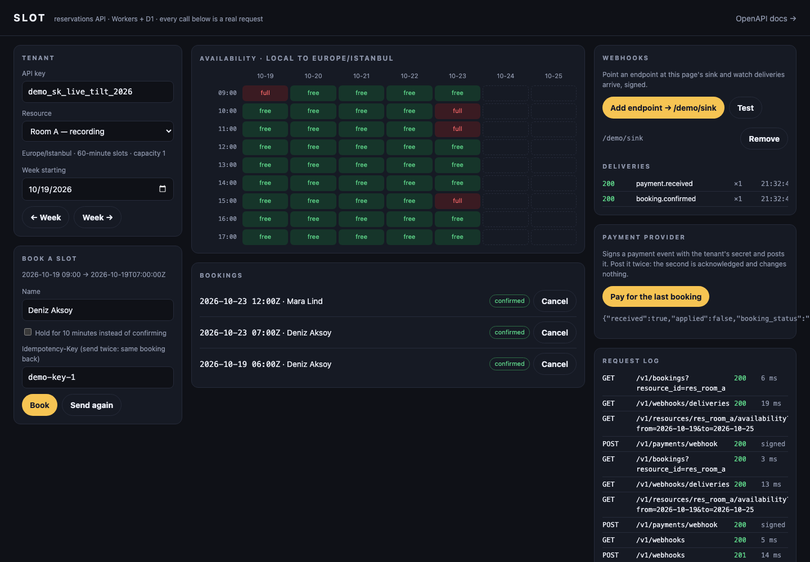

# Slot

A reservations API on Cloudflare Workers and D1: resources with weekly hours in their own time zone, slots in UTC, holds that expire, bookings that cannot double-book, signed webhooks with retries, an idempotent payment hook, and an OpenAPI document generated from the routes' own schemas — so the docs cannot drift from the validation.

**Live:** <https://slot.kocalcengizhan.workers.dev> — the root is a playground that drives the API with a demo key; the docs are at [`/docs`](https://slot.kocalcengizhan.workers.dev/docs).



---

## What it does, and how it is sure

**Time, crossed once.** Everything stored is an instant in UTC with a `Z`; everything a human types is a wall-clock time in a named zone. [`src/lib/time.ts`](src/lib/time.ts) crosses that gap using only `Intl`, which the Workers runtime has and which knows every zone's rules, so there is no offset table to go stale and no dependency to carry. The day the clocks move is a test case: a slot that does not exist is not offered, and a 23- or 25-hour day is a 23- or 25-hour day.

**Capacity, in one statement.** A booking is `INSERT … SELECT … WHERE (count of live overlapping bookings) < capacity`, which SQLite runs atomically. Five simultaneous requests for a three-place class get exactly three `201`s and two `409`s — [`test/api.test.ts`](test/api.test.ts) fires them and counts.

**Holds that expire.** A hold is a booking with a status and an expiry. It counts against capacity until it is confirmed, cancelled, or expires — and an expired hold reads as cancelled the moment it expires, whatever the five-minute cron has got to. The cron then records the cancellation and emits `hold.expired`.

**Idempotency.** Send an `Idempotency-Key` and the first response is stored under it; every repeat gets the same status, the same body, the same booking id, with `Idempotent-Replayed: true`. The same key with a different body is a `422`, because that is not a retry.

**Webhooks you can see.** Every event is written to each matching endpoint's queue, delivered at once, and retried at 1, 5, 30, 120 and 720 minutes. Every attempt is a row the tenant can read, with the last status and error. Deliveries are signed `X-Slot-Signature: t=<unix>,v1=<HMAC-SHA256 of "t.body">`, and the signature is rejected after five minutes.

**A payment hook that cannot double-confirm.** The provider's webhook is verified against the tenant's payment secret and keyed on the provider's own reference, which is unique in the table — a replayed event is acknowledged and changes nothing.

## The API

| | |
| --- | --- |
| `GET /v1/resources` · `POST` · `GET /v1/resources/{id}` | Resources, with a zone, a slot length and a capacity |
| `GET`/`PUT /v1/resources/{id}/rules` | Weekly hours as minutes from local midnight |
| `GET /v1/resources/{id}/availability?from=&to=` | Every slot on each day with how many it can still take, up to 31 days |
| `POST /v1/bookings` | Book, or hold with `hold: true`; `409` says `full`, `outside_hours` or `off_grid` |
| `GET /v1/bookings` · `GET /v1/bookings/{id}` | With payments |
| `POST /v1/bookings/{id}/confirm` · `/cancel` | |
| `POST /v1/payments/webhook` | Signed by the provider, idempotent on `provider_ref` |
| `GET`/`POST`/`DELETE /v1/webhooks` · `/{id}/test` · `/deliveries` | Endpoints, a test event, and every attempt |

Everything under `/v1` wants `Authorization: Bearer <key>` and is limited to sixty requests a minute per key by the Workers rate-limiting binding — nothing to run, nothing to scale. The payment hook is the exception: it is signed instead.

## The checks

Thirty-six tests, all inside workerd with the real bindings — a D1 database per file with the migrations applied, the rate limiter, the cron handler — through [`@cloudflare/vitest-pool-workers`](https://developers.cloudflare.com/workers/testing/vitest-integration/). The time arithmetic is tested on Istanbul, New York, London, Kolkata and Auckland, across both clock changes. The API tests drive `SELF.fetch` as a client would: a wrong key, a bad zone, a full slot, an off-grid time, a race for the last place, a hold aged past its expiry, a replayed key, a replayed payment, a failed delivery scheduled for retry, the cron.

## Running it

Node 24 LTS. A Cloudflare account for D1 — the free tier is more than this needs.

```bash
npm install
npm run migrate:local && npm run seed:local
npm run dev            # http://localhost:8787 — the playground, /docs, /v1

npm run check          # typecheck, lint, 36 tests in workerd
npm run deploy         # applies migrations to the remote D1, then deploys
npm run seed:remote    # the demo tenant and fleet
```

The demo key and payment secret are in `wrangler.jsonc` as plain vars on purpose: they open a demo tenant and nothing else. A real tenant's key is shown once at creation and only its hash is stored.

## Stack

Hono 4 · `@hono/zod-openapi` with Zod 4 · Swagger UI · Cloudflare Workers · D1 · Workers Rate Limiting · Cron Triggers · Vitest 4 in workerd · TypeScript 6.

No ORM, no date library: the queries are typed functions in one file, and the time arithmetic is four functions over `Intl`.
