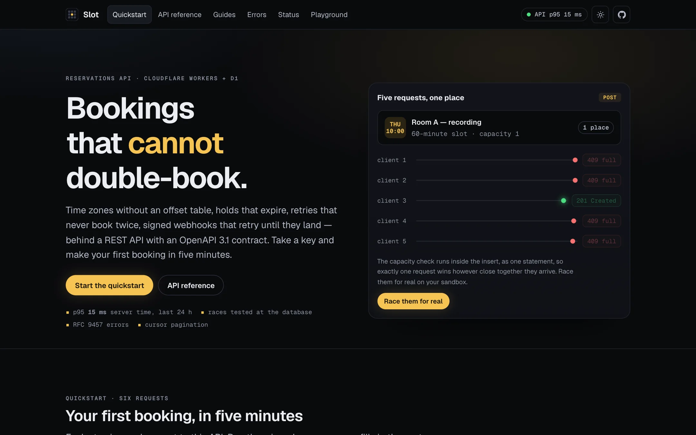
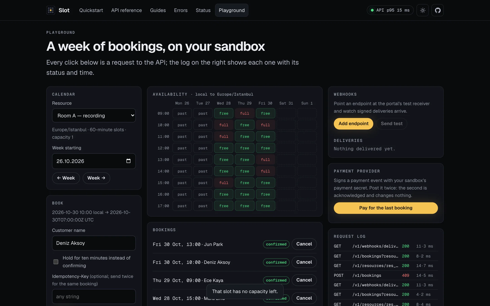
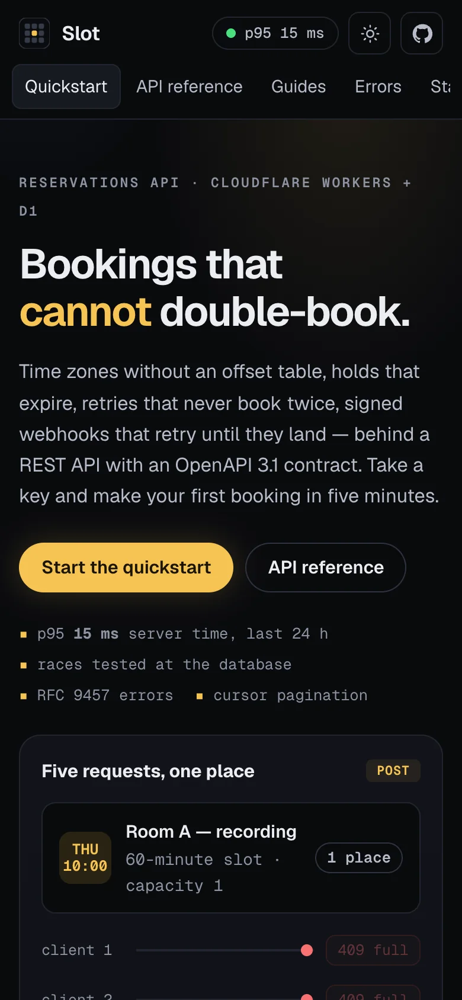
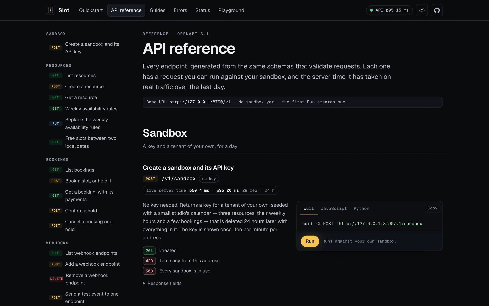
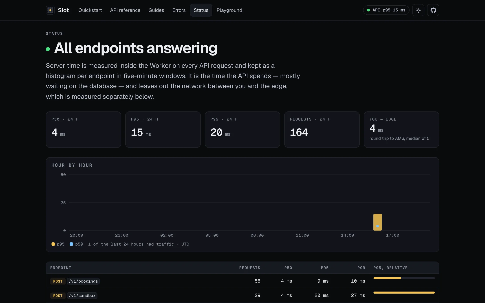

# Slot

A reservations API on Cloudflare Workers and D1, with the developer portal a real API product ships: a five-minute quickstart, a reference generated from the routes' own schemas, an error catalogue, a live status page and a playground that runs on your own sandbox.

**Live:** <https://slot.kocalcengizhan.workers.dev> — the portal; the API is under `/v1`, the contract at [`/openapi.json`](https://slot.kocalcengizhan.workers.dev/openapi.json).



## In three seconds

- **Bookings that cannot double-book**, holds that expire, retries that never book twice, signed webhooks that retry until they land — and the races are tested at the database, not assumed.
- **A portal, not a Swagger page:** quickstart in six requests, OpenAPI 3.1 reference with copy-ready code, RFC 9457 error catalogue, p50/p95/p99 status from real traffic, and a playground where every click is a request in a visible log.
- **Safe to leave public:** every visitor gets a private sandbox that expires in 24 hours; webhook URLs are checked for SSRF; rate limits per key and per IP. Lighthouse mobile **100** on all five portal pages, **62 tests** inside workerd.

---

## Challenge → solution → result

| The problem | What was built | Result |
| --- | --- | --- |
| A shared public demo key let one visitor fill or wipe the demo for everyone (OWASP API4) | Per-visitor sandboxes: seeded resources, a payment secret, 10 resources / 300 bookings / 3 webhooks each, gone after 24 h, at most 2,000 alive, created at 10 a minute per IP | Nobody can touch anyone else's data; storage is bounded |
| Webhook URLs were fetched as given — a server-side request forgery opening (OWASP API7) | HTTPS on the default port to a public DNS name; IP literals in any spelling, single-label hosts and private-network names refused | Covered by unit tests over the spellings that slip past naive checks (`0x7f.1`, `2130706433`) |
| "Exactly once" was claimed, not shown: HTTP tests run one at a time | Capacity and idempotency enforced in single SQL statements, and [`test/races.test.ts`](test/races.test.ts) fires concurrent claims straight at D1 | 5 simultaneous claims → exactly 1 owns the key; a 3-place slot → exactly 3 of 5; both tests shown failing against a check-then-insert version |
| Errors were ad-hoc JSON, lists unbounded | RFC 9457 `application/problem+json` with a documented type per error; cursor pagination on every list | Every error type has a page in the catalogue, linked from the response |
| Speed was a claim | A latency histogram per operation in D1, `Server-Timing` on every response, D1 read replication with session bookmarks | The status page shows p50/p95/p99 per endpoint from real requests; about 4 ms median server time locally |

<p>
  
  
</p>





## What it does, and how it is sure

**Time, crossed once.** Everything stored is a UTC instant; everything a human types is a wall-clock time in a named zone. [`src/lib/time.ts`](src/lib/time.ts) crosses that gap with `Intl` alone — no offset table to go stale. A slot that does not exist on the day the clocks move is not offered, and a 23- or 25-hour day is a 23- or 25-hour day.

**Capacity, in one statement.** A booking is `INSERT … SELECT … WHERE (live overlapping bookings) < capacity`, which SQLite runs atomically.

**Idempotency that survives a race.** The key is claimed with one upsert before any work happens; the winner stores its response, every repeat replays it with `Idempotent-Replayed: true`, and the same key with a different body is a `422`.

**Webhooks you can see.** Every attempt is a row the tenant can read. Retries at 1, 5, 30, 120 and 720 minutes; deliveries signed `X-Slot-Signature: t=<unix>,v1=<HMAC-SHA256>` and rejected after five minutes.

**A payment hook that cannot double-confirm.** Verified against the tenant's payment secret and keyed on the provider's own reference — a replayed event is acknowledged and changes nothing.

## The API

| | |
| --- | --- |
| `POST /v1/sandbox` | A private sandbox key, seeded, for 24 hours |
| `GET`/`POST /v1/resources` · `GET /v1/resources/{id}` | Resources with a zone, a slot length and a capacity |
| `GET`/`PUT /v1/resources/{id}/rules` | Weekly hours as minutes from local midnight |
| `GET /v1/resources/{id}/availability?from=&to=` | Every slot with how many it can still take, up to 31 days |
| `POST /v1/bookings` · `GET /v1/bookings` · `GET /v1/bookings/{id}` | Book, or hold with `hold: true`; lists are cursor-paginated |
| `POST /v1/bookings/{id}/confirm` · `/cancel` | |
| `POST /v1/payments/webhook` | Signed by the provider, idempotent on `provider_ref` |
| `GET`/`POST`/`DELETE /v1/webhooks` · `/{id}/test` · `/deliveries` | Endpoints, a test event, every attempt |

Everything under `/v1` takes `Authorization: Bearer <key>` and is limited to 60 requests a minute per key by the Workers rate-limiting binding.

## Checks

`npm run check` runs both TypeScript configs (the Worker and the portal's browser scripts), ESLint and **62 tests inside workerd** with the real bindings — a D1 database per file with the migrations applied, the rate limiters, the cron handler — through `@cloudflare/vitest-pool-workers`. Time arithmetic is tested on Istanbul, New York, London, Kolkata and Auckland across both clock changes; the API tests drive `SELF.fetch` as a client would; the portal tests check that every problem's `type` link resolves to a documented error, every operation in the contract appears in the reference, and every page carries a title, a description and a share image.

## Running it

Node 24 LTS. A Cloudflare account for D1 — the free tier is more than this needs.

```bash
npm install
npm run migrate:local
npm run dev            # http://localhost:8787 — the portal, /v1, /openapi.json
npm run check          # typecheck, lint, 62 tests in workerd
npm run deploy         # applies migrations to the remote D1, then deploys minified
```

No secrets live in the repository: sandbox keys are issued at runtime and only their hashes are stored.

## Stack

Hono 4.13 · `@hono/zod-openapi` (OpenAPI 3.1) with Zod 4 · Cloudflare Workers, D1 (read replication), Workers Rate Limiting, Cron Triggers, Static Assets · Vitest 4 in workerd · TypeScript 6.

No ORM, no date library, no front-end framework: the queries are typed functions in one file, the time arithmetic is four functions over `Intl`, and the portal is server-rendered HTML with three small type-checked scripts.
